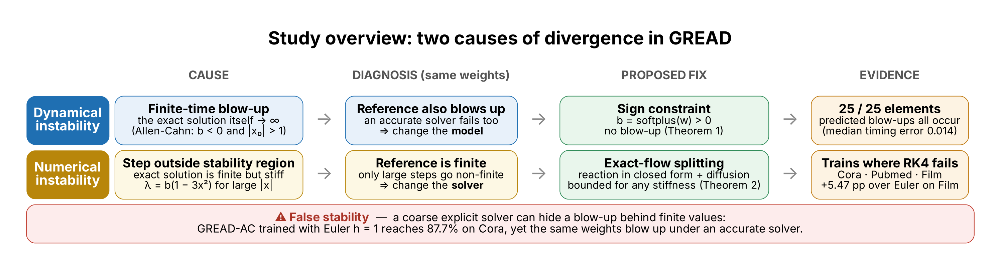
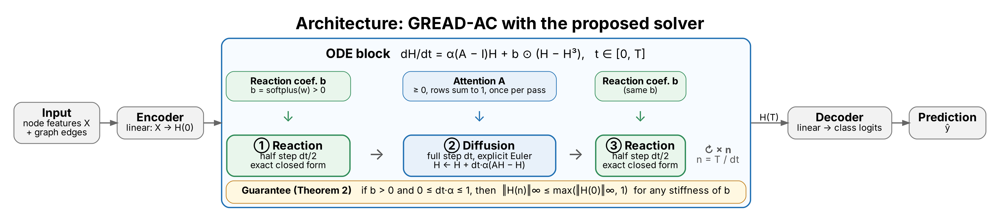
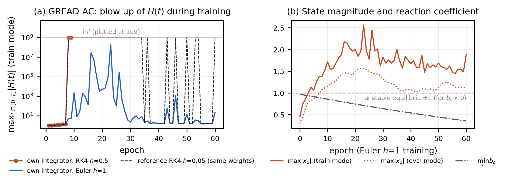
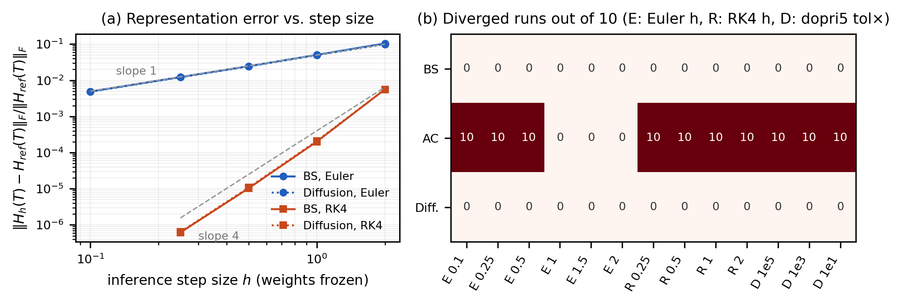

# 연속 깊이 신경망 학습 발산의 두 원인과 안정한 반응-확산 적분

**동역학적·수치적 불안정성의 구분**
*Two Causes of Divergence in Continuous-Depth Networks and a Stable Reaction-Diffusion Integrator*

반응-확산 GNN([GREAD](https://github.com/jeongwhanchoi/GREAD), ICML 2023)과 그래프가 없는 Neural ODE에서, 학습이 NaN으로 발산하는 원인을 **연속 방정식 자체의 폭주(동역학적)** 와 **적분기의 안정 영역 이탈(수치적)** 로 나누어 예측·검증하고, 두 원인을 각각 제거하는 적분 방법(부호 제약 + 정확해 분할 적분)을 제안한 실험 코드입니다. KSC 2026 학부생 논문(심사 중) 실험을 모두 재현할 수 있습니다.

**핵심 결과**

- **거친 적분기로 얻은 높은 정확도는 학습된 모델이 연속 ODE의 정상적인 해라는 것을 보장하지 않는다.** Euler h=1로 87.7%를 낸 GREAD-AC와 73.0%를 낸 cubic Neural ODE는, 같은 가중치를 정밀 적분기로 풀면 연속 해가 유한 시간에 폭주한다(거짓 안정).
- GREAD 반응항 8개 설정 중 폭주 없음이 이론적으로 보장되는 4개는 모두 정밀 적분으로 학습되었고, 스칼라 조건이 폭주를 예측한 4개는 모두 발산했다.
- 해석해가 폭주를 예측한 원소 25개(159,040개 중)는 반응만 남긴 모델에서 정확히 그 25개가 폭주했고, 시각 오차 중앙값은 0.014였다.
- 같은 체크포인트에서 step만 줄이면 거짓 안정이 사라지고, 폭주 시각이 기준해(t = 2.66)로 수렴한다.
- 동역학이 안정한 반응항(BS, 확산)은 Euler h=2(NFE 2)와 RK4 h=0.25(NFE 64)의 정확도가 같았다.
- **제안법**(부호 제약 + 정확해 분할 적분)은 같은 부호 제약에서 RK4가 10/10 발산하는 Cora·Pubmed 설정과 강성이 극단적인 Film에서 NFE 1–4로 모두 학습되었고, 같은 가중치의 기준해와 정확도 차이는 0.23%p 이하였다.

<p align="center">
  
</p>

## 목차

1. [문제 설정](#1-문제-설정)
2. [이론: 두 원인을 가르는 조건](#2-이론-두-원인을-가르는-조건)
3. [제안법: 부호 제약과 정확해 분할 적분](#3-제안법-부호-제약과-정확해-분할-적분)
4. [실험 구성](#4-실험-구성)
5. [결과](#5-결과)
6. [저장소 구조](#6-저장소-구조)
7. [재현 방법](#7-재현-방법)
8. [한계와 후속 연구](#8-한계와-후속-연구)
9. [참고문헌](#9-참고문헌)

## 1. 문제 설정

연속 깊이 신경망은 은닉 상태를 ODE `dh/dt = f_θ(h)`로 정의하고 수치 적분기로 순전파를 계산한다. 학습이 NaN으로 발산하면 보통 step을 줄이거나 적분기를 바꾸지만, 발산에는 처방이 다른 두 원인이 있다.

| | 동역학적 불안정성 | 수치적 불안정성 |
|---|---|---|
| 무슨 일이 일어나나 | 연속 해가 적분 구간 안에서 무한대로 간다 | 해는 유한하지만 step이 적분기 안정 영역을 벗어나 오차가 증폭된다 |
| step을 줄이면 | 해결되지 않는다 | 해결된다 |
| 처방 | 모델을 바꾼다(반응 계수 부호, 적분 시간 T) | step을 줄이거나 적응형·암시적 적분기를 쓴다 |

여기에 세 번째 현상이 겹친다. **거친 명시적 적분기는 동역학적 폭주를 가릴 수 있다.** [0, T]를 N = ⌈T/h⌉번의 다항 사상으로 근사하므로, N이 작으면 연속 해가 폭주해도 이산 해는 유한하게 남는다(N = 1이면 항상 유한). 학습은 정상처럼 보이지만 모델은 특정 이산화에 묶인 함수가 된다. 이 저장소는 이를 **거짓 안정(false stability)** 이라고 부른다.

## 2. 이론: 두 원인을 가르는 조건

다루는 벡터장은 선형 이하로 자라는 항 g와 채널별 다항 반응항의 합이다. GREAD에서 g는 확산항 α(A − I)H, 일반 Neural ODE에서는 tanh MLP다.

```text
dh/dt = g(h) + b ⊙ r(h),    ‖g(h)‖ ≤ A + B‖h‖
```

**동역학적 불안정성.** r = 0이면 Grönwall 부등식에 의해 해는 유한 시간에 폭주하지 않는다(확산, BS, tanh MLP). 다항 반응항이 있으면 폭주 여부는 최고차항의 부호와 초기 상태의 영역이 정한다.

| 반응항 | r(x) | b < 0 | b > 0 |
|---|---|---|---|
| Allen-Cahn (AC) | x − x³ | \|x₀\| > 1이면 폭주 | 폭주 없음 |
| Fisher (F) | x − x² | x₀ > 1이면 폭주 | x₀ < 0이면 폭주 |
| Zeldovich (Z) | x² − x³ | x₀ < 0 또는 x₀ > 1이면 폭주 | 폭주 없음 |

AC에서 b < 0, |x₀| > 1이면 스칼라 폭주 시간은 다음과 같다.

```text
t* = ln( x₀² / (x₀² − 1) ) / (2|b|)
```

위 표는 확산을 무시한 스칼라 조건이라 전체 시스템에 대해서는 **예측**으로만 쓴다. 결합된 계에서는 확산이 폭주를 늦추거나 막을 수도 있다(예: 두 노드 x₁ = u, x₂ = −u, b = −1, α = 1이면 du/dt = u³ − 3u로, |u₀| < √3이면 폭주하지 않는다).

**정리 1 (그래프 전체의 폭주 하한).** GREAD는 어텐션 A를 적분 전에 한 번 계산하고 계수가 채널별이므로 채널마다 독립인 계 dh/dt = α(A − I)h + b·r(h)가 된다. α ≥ 0이고(GREAD는 α = sigmoid(·)) Cora·Film의 A는 행별 softmax로 정규화된 비음수 행 확률행렬이므로, M(t) = ‖h(t)‖∞의 상우 Dini 미분은 D⁺M ≤ b(M − M³)를 만족한다(최댓값을 갖는 노드가 바뀌는 순간 M은 미분 불가능할 수 있다). 따라서 b > 0이면 ‖h(t)‖∞ ≤ max(M(0), 1)이고, b < 0이면 M(0) ≤ 1일 때 폭주가 없으며 폭주하더라도 그 시각은 t*(M(0), b) 이후다. 즉 스칼라 t*는 전체 계 폭주 시각의 **하한**일 뿐이다.
 반면 b > 0인 AC·Zeldovich는 x·b·r(x)가 위로 유계(AC ≤ b/4, Z ≤ 27b/256)다. GREAD는 어텐션 가중치를 적분 전에 한 번 계산하므로 적분 중 확산항이 H에 선형이다. 따라서 ⟨H, f(H)⟩ ≤ a + c‖H‖²가 성립하고, 확산을 포함한 전체 시스템에서도 유한시간 폭주가 없음이 **보장**된다.

**수치적 불안정성.** 해가 유한해도 선형화 고유값 λ에 대해 hλ가 안정 영역을 벗어나면 오차가 증폭된다. 실수축에서 Euler는 −2 ≤ hλ ≤ 0, 고전 RK4는 −2.785 ≤ hλ ≤ 0이다. AC에서 λ = b(1 − 3x²)이므로 b > 0으로 폭주를 없애도 |x|가 크면 강성(stiff)이 되어 큰 step에서 발산할 수 있다.

**3단계 진단 절차.**

1. 발산하거나 거친 적분기로만 학습되면, 같은 가중치로 기준 적분(작은 step 또는 적응형)을 [0, T]에서 구한다.
2. 기준 해도 폭주하면 동역학적 불안정성이다. 표의 조건과 t*로 폭주 원소를 특정하고, step이 아니라 모델을 바꾼다. 거친 적분기로 학습에 성공했다면 그 결과는 거짓 안정이다.
3. 기준 해가 유한하고 step을 줄이면 회복되면 수치적 불안정성이다.

## 3. 제안법: 부호 제약과 정확해 분할 적분

진단에서 AC 발산의 원인은 (1) b < 0 채널의 유한시간 폭주와 (2) b > 0에서도 |x|가 클 때의 강성이었다. 제안법은 둘을 각각 구조적으로 제거한다.

1. **부호 제약:** b = softplus(w) > 0. 학습 중 어떤 값에서도 정리 1의 유계 조건을 만족한다.
2. **정확해 분할 적분:** 한 step을 반응 dt/2 → 확산 dt → 반응 dt/2로 나눈다(Strang형 분할). 반응은 닫힌 해로 정확히 풀고, 확산은 명시적 Euler로 푼다.

<p align="center">
  
</p>

GREAD는 인코더 → ODE 블록 → 디코더 구조이고, 제안법은 ODE 블록의 적분기만 교체한다. 어텐션 A는 적분 전에 한 번 계산되므로 적분 중 확산항은 H에 선형이다. 대조군 실험에서는 같은 블록을 Euler·RK4·dopri5(torchdiffeq)로 푼다.

```text
x(t) = x·exp(bt) / sqrt(1 + x²(exp(2bt) − 1))
```

**정리 2 (이산 최대값 원리).** b > 0이고 0 ≤ dt·α ≤ 1이면 모든 step에서 ‖H(n)‖∞ ≤ max(‖H(0)‖∞, 1)이다. 반응의 정확해는 |x|를 max(|x|, 1) 이하로 유지하고, 확산 step (1 − dt·α)H + dt·α·AH는 행 합 1인 비음수 행렬의 볼록결합이기 때문이다. 이 보장은 **순전파 상태의 유계성**이며, 역전파·최적화의 안정성은 포함하지 않는다.

- 이 성질은 **반응항의 강성과 무관**하다. 남는 조건은 확산 step의 0 ≤ dt·α ≤ 1뿐이다. GREAD는 α = sigmoid(·) ∈ (0, 1)이므로 dt ≤ 1이면 충분하다. step 크기와 완전히 무관한 것은 아니다.
- 확산 단계가 Euler이므로 전체 정확도는 **1차**다(실측: h를 100배 줄이면 오차 6.2×10⁻² → 6.1×10⁻⁴).
- b < 0이면 반응 부분문제의 유한시간 폭주를 정확히 검출하므로, 거친 Euler처럼 이를 유한값으로 통과하지 않는다. 확산을 포함한 전체 계가 반드시 폭주한다는 뜻은 아니다.
- 연산자 분할과 최대값 원리 보존은 수치해석의 고전적 기법이다. 여기서의 기여는 이를 진단된 두 원인에 대응시켜 Neural ODE 학습에 적용하고, 같은 가중치의 정밀 적분으로 검증한 것이다.

## 4. 실험 구성

| 항목 | 설정 |
|---|---|
| 모델 | GREAD 공개 코드(원본 `run_GNN.py`는 수정하지 않고 별도 러너 `rd_sweep.py` 사용) |
| 데이터 | Cora, Film, Texas, Wisconsin, Pubmed(제안법 실험, 노드 19,717개) (Geom-GCN 10개 분할) |
| 하이퍼파라미터 | 데이터셋별 공개 BS 최적값으로 고정(Cora: T = 3.79, 입력 dropout 0.50) |
| 반응항 | 확산(반응 없음), BS, AC, Fisher, Zeldovich, 그리고 b = softplus(w) > 0 제약 버전 |
| 반응 계수 | 채널별 b, U(−1, 1) 초기화 |
| 적분 설정 | Euler h ∈ {0.1, 0.25, 0.5, 1, 1.5, 2}, RK4 h ∈ {0.25, 0.5, 1, 2}, dopri5(tol_scale 1e1, 1e3, 1e5) |
| 규모 | 약 1,370회 학습 (1차 스윕 390회 + 2차 스윕 984회) |
| 기준해 | 같은 가중치의 RK4 h = 0.05 (GREAD), 0.01 (Neural ODE) |
| 발산 판정 | 손실·출력의 NaN, NFE 한도 초과, 적분기 오류 |
| 재현 확인 | Cora BS 87.85 ± 0.81% (원 논문 88.57 ± 0.66%) |

`rd_sweep.py`가 원본 `run_GNN.py`와 다른 점은 공정성 통제를 위한 것이다.

- best params를 먼저 적용한 뒤 실험 변수(반응항, 적분기, step, tol, T)를 명령줄 값으로 **마지막에** 덮어쓴다. 원본은 best params가 명령줄 값을 덮어쓴다.
- 실제 적용된 설정값을 결과 JSON에 그대로 기록한다.
- 분할마다 torch/numpy 시드를 고정한다.
- 발산을 잡아서 기록하고 다음 실험으로 넘어간다.
- 학습·평가 forward NFE, epoch당 시간, Dirichlet energy를 따로 잰다.

**그래프 없는 Neural ODE.** two-moons 분류에서 `Linear(2, 32) → dh/dt = MLP_tanh(h) [+ b ⊙ (h − h³)] → Linear(32, 2)`, T = 4로 학습한다. 비교 모델은 셋이다: 3차항이 없는 MLP, b 부호가 자유로운 cubic, b > 0인 cubic+.

## 5. 결과

### 5.1 이론 예측과 관측 (GREAD, Cora)

테스트 정확도(%, 10분할 평균). '발산'은 10/10 발산. † 전체 시스템에서 폭주 없음 보장, ‡ 스칼라 조건에 의한 폭주 예측.

| 반응항 | 이론 | RK4 h=0.25 | dopri5 | RK4 h=1 | Euler h=1 |
|---|---|---:|---:|---:|---:|
| 확산 | 안정† | 87.79 | 87.93 | 87.93 | 87.77 |
| BS | 안정† | 88.11 | 87.93 | 87.89 | 87.71 |
| AC | 불안정‡ | 발산 | 발산 | 발산 | 87.71 |
| AC (b>0) | 안정† | 87.89 | 87.85 | 발산 | 87.91 |
| F | 불안정‡ | 발산 | 발산 | 발산 | 87.79 |
| F (b>0) | 불안정‡ | 발산 | 발산 | 발산 | 87.34 |
| Z | 불안정‡ | 발산 | 발산 | 발산 | 87.36 |
| Z (b>0) | 안정† | 87.79 | 87.79 | 발산 | 87.34 |

- Fisher는 b > 0으로 제약해도 x < 0 쪽에서 폭주한다는 예측대로 정밀 적분에서 모두 발산했다.
- AC(b>0)와 Z(b>0)는 RK4 h=1에서만 10/10 발산했고 step을 줄이면 회복됐다. 동역학은 안정하고 강성 때문에 생긴 **수치적** 불안정성이다.
- 동역학적으로 불안정한 4개 설정은 모두 거친 Euler에서만 학습되었다.

### 5.2 폭주의 원소 단위 검증

AC를 RK4 h=0.5로 8 epoch 학습한 가중치를 고정했다. 스윕에서는 이 설정이 9 epoch에 NaN이 됐다.

| 항목 | 결과 |
|---|---|
| 해석해 t* < T 로 폭주가 예측된 원소 | 159,040개 중 25개 |
| 반응만 남긴 모델에서 실제 폭주한 원소 | 정확히 같은 25개 (모두 b < 0, \|x₀\| > 1) |
| 폭주 시각 예측 오차 중앙값 | 0.014 (시간 격자 0.01 수준) |
| 확산 포함 전체 모델(정밀 적분 RK4 h=0.01)에서 폭주(\|H\| > 10 또는 비유한값)가 처음 관측된 시각 | t = 2.66 (정리 1의 하한 1.47보다 늦음), 첫 폭주 원소는 예측 집합에 속함 |
| 같은 가중치, RK4 h=0.5 / Euler h=1 | max\|H\| = ∞ / 2.58 (거친 Euler가 폭주를 가림) |

학습 중 추적에서는 dropout이 켜진 학습 모드의 max|x₀|가 3 epoch에 1을 넘었고, 8 epoch부터 기준해가 폭주했다. Euler h=1 학습은 이 구간을 최대 1.8×10⁸의 유한값으로 통과했다. 거친 Euler로 초반을 지나고 RK4로 바꾸는 학습은 전환 시점(0, 5, 20, 50 epoch)과 무관하게 모두 발산했다.

<p align="center">
  
</p>

### 5.3 같은 체크포인트에서 step 줄이기

위 체크포인트를 학습 모드 입력(max|x₀| = 1.43)으로 적분하며 |H| > 10이 처음 관측되는 시각을 쟀다.

| 적분기 | h | 첫 \|H\| > 10 시각 | max\|H(T)\| |
|---|---:|---:|---:|
| Euler | 1 | 없음 | 2.58 |
| Euler | 0.5 | 없음 | 6.14 |
| Euler | 0.25 | 3.50 | 폭주 |
| Euler | 0.1 | 3.10 | 폭주 |
| Euler | 0.05 | 2.85 | 폭주 |
| Euler | 0.01 | 2.70 | 폭주 |
| RK4 | 1, 0.5 | 3.0 | 폭주 |
| RK4 | 0.25 | 2.75 | 폭주 |
| RK4 | 0.1 | 2.70 | 폭주 |
| RK4 (기준) | 0.01 | 2.66 | 폭주 |

step을 줄이면 거짓 안정이 사라지고 폭주 시각이 기준해 2.66으로 수렴한다. 같은 가중치의 추론 모드 입력(max|x₀| = 1.09)에서는 모든 설정이 유한(max|H| ≈ 1)했다. 이 체크포인트의 폭주는 dropout으로 커진 학습 모드 상태에서만 생긴다.

### 5.4 그래프 없는 Neural ODE (two-moons)

정확도(%). 괄호는 같은 가중치를 기준해(RK4 h=0.01)로 풀었을 때.

| 모델 | 이론 | RK4 h ≥ 0.25 | RK4 h=0.1 | dopri5 | Euler h=1 |
|---|---|---:|---:|---:|---:|
| MLP | 안정 | 97.6 | — | — | 97.0 (72.1) |
| cubic | 불안정 | 발산 | 발산 | 발산 | 73.0 (10/10 폭주) |
| cubic+ (b>0) | 안정·강성 | 발산 | 96.9 | 97.3 | 69.9 (59.4) |

GNN이 아닌 일반 Neural ODE에서도 같은 세 현상이 나타났다. cubic은 거짓 안정, cubic+는 수치적 불안정성이다. MLP는 발산은 없지만 Euler h=1로 학습한 모델이 기준해에서 97.0 → 72.1로 떨어져, 이산화 의존이 남는다.

### 5.5 안정한 동역학은 적분기에 둔감하다

- 동역학이 안정한 BS·확산은 13개 적분 설정 모두에서 발산이 없었고, 정확도 차이는 0.82%p 이하였다.
- 가중치를 고정하고 추론 적분기만 바꾸면 표현 오차가 Euler에서 h에, RK4에서 약 h⁴에 비례했다.
- Euler h=2(NFE 2)는 RK4 h=0.25(NFE 64)와 같은 정확도를 냈다. Euler h=2로 학습한 BS 모델을 기준해로 풀어도 87.59 → 87.65%로 같았다.

<p align="center">
  
</p>

### 5.6 다른 데이터셋

- **Texas, Wisconsin, Film:** BS는 모든 적분 설정에서 정상 학습됐다.
- **Film:** AC와 AC(b>0)는 정밀 적분기에서 발산했고, 한 번의 step으로 끝나는 Euler h ≥ 0.5에서만 학습됐다. 학습 모드 max|x₀|가 9.46에 이른다.
- **원인 확인:** 같은 가중치에서 RK4 h = 0.05 기준해는 10/10 발산했지만 RK4 h = 0.002와 분할 h = 0.001 기준해는 유한하고 정확도가 일치했다. AC(b>0)가 dopri5까지 발산한 원인은 폭주가 아니라 **강성**이다.

### 5.7 같은 가중치에서 적분기만 바꾸기 (수치적 불안정성의 직접 검증)

AC(b>0) 가중치를 고정하고 적분기만 바꿨다(3분할, 오차 = 기준해 RK4 h = 0.01 대비 상대오차).

| 적분기 | Cora 학습 모드 입력 | Pubmed 학습 모드 입력 | Pubmed 추론 입력 |
|---|---|---|---|
| RK4 h=1 | 비유한 3/3 | 비유한 3/3 | 비유한 3/3 |
| RK4 h=0.5 | 유한, 2.0×10⁻⁴ | 비유한 3/3 | 비유한 3/3 |
| RK4 h=0.25 | 유한, 9.5×10⁻⁶ | 비유한 3/3 | 유한 1/3 |
| RK4 h=0.05 | 유한, 2.0×10⁻⁷ | 유한 2/3 | 유한 3/3 |
| dopri5 | 유한, 6.8×10⁻⁷ | 유한 3/3 | 유한 3/3 |
| 제안법 h=1 | 유한 3/3 | 유한 3/3 | 유한 3/3 |

연속 해는 유한하고 step만 안정 영역을 벗어난다. 상태 크기가 큰 입력일수록(|λ| ≈ b(3x² − 1)) 더 작은 step이 필요했다. Cora는 RK4 h = 0.25, Pubmed는 제안법으로 학습한 가중치다.

### 5.8 제안법

부호 제약 AC(b>0), 정확도(%, 10분할 평균±표준편차). 괄호는 같은 가중치의 기준해(RK4 미세 step) 정확도.

| 데이터 | RK4 h=1 | RK4 h=0.25 | Euler h=1 | 제안법 h=1 | 분할별 차이 (제안법 − Euler) |
|---|---|---:|---:|---:|---:|
| Cora | 발산 | 87.89±1.17 | 88.03±1.01 (87.93) | 87.42±1.38 (87.40) | −0.60±1.36 (제안법 우위 3/10) |
| Pubmed | 발산 | 발산 | 89.97±0.37 (89.82) | 89.65±0.44 (89.88) | −0.32±0.44 (2/10) |
| Film | 발산 | 발산 | 31.62±2.73 (31.51) | 37.10±0.95 (37.22) | **+5.47±2.66 (10/10)** |

- 순전파 1회당 NFE는 제안법·Euler h=1이 Cora 4, Pubmed 2, Film 1이다. RK4 h=0.25는 Cora 64, Pubmed 28. 표의 h = 1 실험은 모두 dt ≤ 1(정리 2의 조건)을 만족한다.
- 같은 AC(b>0) 모델의 Pubmed epoch당 학습 시간(GPU 동기화, epoch 평균): 제안법 0.008초, Euler h = 1 0.008초, RK4 h = 0.25 0.050초(발산 전까지). 참고로 BS-RK4 h = 0.25는 0.076초.
- Cora h = 2(NFE 2)도 87.53%로 학습됐지만, dt ≈ 1.9라 정리 2의 보장 범위를 벗어날 수 있다.
- 부호 제약이 없는 AC에서는 제안 적분기도 Cora·Film 10/10 발산했다(반응 부분문제의 폭주를 유한값으로 통과하지 않음).
- Cora·Pubmed에서는 Euler가 평균 0.3–0.6%p 높았지만 차이는 분할 간 편차 수준이다. 제안법의 이점은 정확도가 아니라 RK4가 실패하는 설정의 학습, 정리 2의 보장, 강성이 큰 Film에서의 성능(+5.5%p)이다.

## 6. 저장소 구조

```text
.
├── rd_sweep.py        # 메인 러너: 반응항 × 적분 설정 × 분할, 발산·NFE·시간·Dirichlet energy 기록
├── run_sweep.sh       # 1차 스윕(Cora, BS/AC/확산 × 13개 적분 설정 × 10분할), 끊겨도 이어서 실행
├── run_sweep2.sh      # 2차 스윕(Fisher/Zeldovich/부호 제약, 다른 데이터셋)
├── analyze.py         # sweep.jsonl → 표(CSV/Markdown) + 그림
├── cross_eval.py      # 가중치 고정, 추론 적분기만 교체: 정확도·예측 변경률·표현 오차
├── cross_summary.py   # cross_eval 결과 요약 표
├── diag_ac.py         # AC 발산 진단: 스윕 요약 + 초기화 직후 궤적
├── diag_train.py      # 학습 중 epoch별 max|x₀|, 반응 계수, 기준해 폭주 추적
├── train_switch.py    # Euler → RK4 전환 학습
├── diag_channel.py    # (노드, 채널) 원소 단위 폭주 검증, 해석해 t*와 비교
├── step_refine.py     # 같은 체크포인트에서 step을 줄이며 폭주 관측 변화 확인
├── toy_node.py        # 그래프 없는 Neural ODE(two-moons) 일반화 실험
├── make_figs.py       # 논문 그림(fig_conv_div, fig_mechanism) 생성
├── split_run.py       # 제안법(부호 제약 + 정확해 분할 적분) 학습·기준해 검증, --plain euler 로 대조군
├── run_split.sh       # 제안법 본 실험(Cora/Film/Pubmed + 기존 적분기 대조군)
├── run_split2.sh      # 제안법 vs Euler, 두 가지 기준해(RK4 미세 step, 분할 미세 step)
├── fixed_ckpt.py      # 같은 가중치에서 적분기만 바꿔 수치적 불안정성 직접 확인
├── figs/              # README 구상도(overview.png, architecture.png)와 Graphviz 원본(.dot)
└── results/           # 실험 결과 jsonl, 표, 그림
```

| 결과 파일 | 만드는 스크립트 |
|---|---|
| `results/sweep.jsonl` | `run_sweep.sh` |
| `results/sweep2.jsonl` | `run_sweep2.sh` |
| `results/crosseval.jsonl` | `cross_eval.py` |
| `results/switch.jsonl` | `train_switch.py` |
| `results/diag_train.jsonl` | `diag_train.py` |
| `results/report/` | `analyze.py` |
| `results/figs/` | `make_figs.py` |
| `results/split.jsonl`, `results/split_base.jsonl` | `run_split.sh` |
| `results/split2.jsonl` | `run_split2.sh` |
| `results/fixed_ckpt.jsonl` | `fixed_ckpt.py` |

## 7. 재현 방법

### 7.1 환경

Python 3.9, CUDA 12.8(RTX 50 시리즈의 sm_120 지원 때문에 cu128 사용)에서 실행했다.

```bash
conda create -n gread python=3.9 -y
conda activate gread
pip install torch==2.7.1 --index-url https://download.pytorch.org/whl/cu128
pip install torch-scatter torch-sparse -f https://data.pyg.org/whl/torch-2.7.0+cu128.html
pip install torch-geometric==2.3.1 "numpy<2" scikit-learn==1.2.2 torchdiffeq==0.2.3 \
            pykeops numba pandas matplotlib tabulate
```

- `scikit-learn`은 1.2.2로 고정해야 GREAD 코드의 `DistanceMetric` import가 동작한다.
- 최근 PyTorch의 `torch.load(weights_only=True)` 기본값 문제는 `rd_sweep.py`가 내부에서 처리한다.

### 7.2 GREAD 코드 연결

모든 스크립트는 GREAD의 `src/` 안에서 실행되도록 작성했다. 원본 코드는 수정하지 않고 심볼릭 링크로 연결한다.

```bash
git clone https://github.com/jeongwhanchoi/GREAD.git
git clone https://github.com/ghdwldbs04/gread-integration-sensitivity.git repo
for f in repo/*.py repo/*.sh; do ln -sf "$(realpath "$f")" GREAD/src/; done
ln -sfn "$(realpath repo/results)" GREAD/results
cd GREAD/src
```

Geom-GCN 분할 파일(`*_split_0.6_0.2_{0..9}.npz`)은 `GREAD/src/splits/`에 둔다.

### 7.3 실험 실행 (GREAD/src 에서)

```bash
# 1차 스윕 (Cora). 끊겨도 다시 실행하면 끝난 설정은 건너뜀
setsid nohup bash run_sweep.sh > ../results/sweep.log 2>&1 &

# 2차 스윕 (반응항 차수·부호 제약, 다른 데이터셋)
setsid nohup bash run_sweep2.sh > ../results/sweep2.log 2>&1 &

# 단일 실행 예시
python rd_sweep.py --reaction allen-cahn --beta_pos --method rk4 --step_size 0.25 --splits 0 1 2
```

`rd_sweep.py` 주요 인자:

| 인자 | 설명 |
|---|---|
| `--dataset` | Cora, film, texas, wisconsin 등 |
| `--reaction` | `bspm`, `allen-cahn`, `fisher`, `zeldovich`, `diffusion` |
| `--beta_pos` | 반응 계수를 b = softplus(w) > 0 으로 제약 |
| `--method` | `euler`, `rk4`, `midpoint`, `dopri5` |
| `--step_size` / `--tol_scale` | 고정 step / dopri5 허용오차 배율 |
| `--time` | 적분 종료 시간 T (기본: best params) |
| `--max_nfe` | 이 값을 넘으면 발산으로 기록 (기본 5000) |
| `--splits` | 사용할 분할 번호 |

```bash
# 가중치 고정 후 추론 적분기 교체
python cross_eval.py --reaction bspm --method rk4 --step_size 0.5
python cross_eval.py --reaction allen-cahn --method euler --step_size 1.0
python cross_summary.py ../results/crosseval.jsonl

# 폭주 메커니즘
python diag_train.py --method rk4 --step_size 0.5 --epochs 15
python diag_train.py --method euler --step_size 1.0 --epochs 60
python train_switch.py --reaction allen-cahn --switch 0 5 20 50
python diag_channel.py --epochs 8
python step_refine.py

# 그래프 없는 Neural ODE
python toy_node.py --out ../results/toy_node.jsonl \
  --solvers euler:1.0,rk4:0.25,rk4:0.1,dopri5:0 --kinds mlp,cubic,cubic+

# 제안법
bash run_split.sh > ../results/split.log 2>&1
bash run_split2.sh > ../results/split2.log 2>&1
python split_run.py --dataset Cora --beta_pos --step_size 1.0            # 단일 실행
python fixed_ckpt.py --dataset Cora --train rk4 --train_h 0.25 --splits 0 1 2
python fixed_ckpt.py --dataset Pubmed --train split --train_h 1.0 --splits 0 1 2

# 표와 그림
python analyze.py ../results/sweep.jsonl ../results/report
python make_figs.py ../results ../results/figs
```

## 8. 한계와 후속 연구

**한계**

- 정리 1은 폭주 시각의 하한만 준다. 폭주가 실제로 일어나는지는 스칼라 조건으로 예측하며, 그래프 전체에 대한 폭주 발생 조건(상한)은 아직 없다.
- 제안 적분기는 AC 반응항에 한정되고, 1차 정확도이며, 정리 2는 dt·α ≤ 1에서만 보장된다. 동질 그래프에서는 Euler보다 정확도가 약간 낮았다.
- GREAD 실험은 데이터셋별 BS 최적값을 공통으로 썼다. 원 논문의 AC 전용 설정과 직접 비교되지 않는다. 따라서 결과의 뜻은 "AC는 정밀 적분으로 학습되지 않는다"가 아니라 "같은 설정에서 반응항과 적분기 조합에 따라 안정성이 달라지며, 그 원인을 예측할 수 있다"이다.
- Neural ODE 실험은 소규모다(시드 10개).

**후속 연구**

1. **폭주 발생 조건(상한).** Kaplan 고유벡터 방법으로 그래프 전체 계의 폭주 시간 상한을 유도해 정리 1의 하한과 짝을 맞춘다.
2. **제안법 확장.** Fisher·Zeldovich 반응항의 정확해 분할, 2차 정확도 확산 단계, 대규모 그래프, ACMP·IMEX 적분기와의 비교.

## 9. 참고문헌

1. R. T. Q. Chen, Y. Rubanova, J. Bettencourt, D. Duvenaud. Neural Ordinary Differential Equations. NeurIPS, 2018.
2. E. Haber, L. Ruthotto. Stable Architectures for Deep Neural Networks. Inverse Problems, 34(1), 2017.
3. B. P. Chamberlain et al. GRAND: Graph Neural Diffusion. ICML, 2021.
4. J. Choi, S. Hong, N. Park, S.-B. Cho. GREAD: Graph Neural Reaction-Diffusion Networks. ICML, 2023.
5. K. Ott, P. Katiyar, P. Hennig, M. Tiemann. ResNet After All? Neural ODEs and Their Numerical Solution. ICLR, 2021.
6. A. Zhu, P. Jin, B. Zhu, Y. Tang. On Numerical Integration in Neural Ordinary Differential Equations. ICML, 2022.
7. H. Pei, B. Wei, K. C.-C. Chang, Y. Lei, B. Yang. Geom-GCN: Geometric Graph Convolutional Networks. ICLR, 2020.
8. Y. Wang, K. Yi, X. Liu, Y. G. Wang, S. Jin. ACMP: Allen-Cahn Message Passing with Attractive and Repulsive Forces for Graph Neural Networks. ICLR, 2023.
9. E. Hairer, G. Wanner. Solving Ordinary Differential Equations II: Stiff and Differential-Algebraic Problems. Springer, 1996.
10. J. Kelly, J. Bettencourt, M. J. Johnson, D. Duvenaud. Learning Differential Equations that are Easy to Solve. NeurIPS, 2020.
11. S. Kim, W. Ji, S. Deng, Y. Ma, C. Rackauckas. Stiff Neural Ordinary Differential Equations. Chaos, 31(9), 2021.
12. E. Haber, K. Lensink, E. Treister, L. Ruthotto. IMEXnet: A Forward Stable Deep Neural Network. ICML, 2019.
13. T. K. Rusch, B. Chamberlain, J. Rowbottom, S. Mishra, M. Bronstein. Graph-Coupled Oscillator Networks. ICML, 2022.
