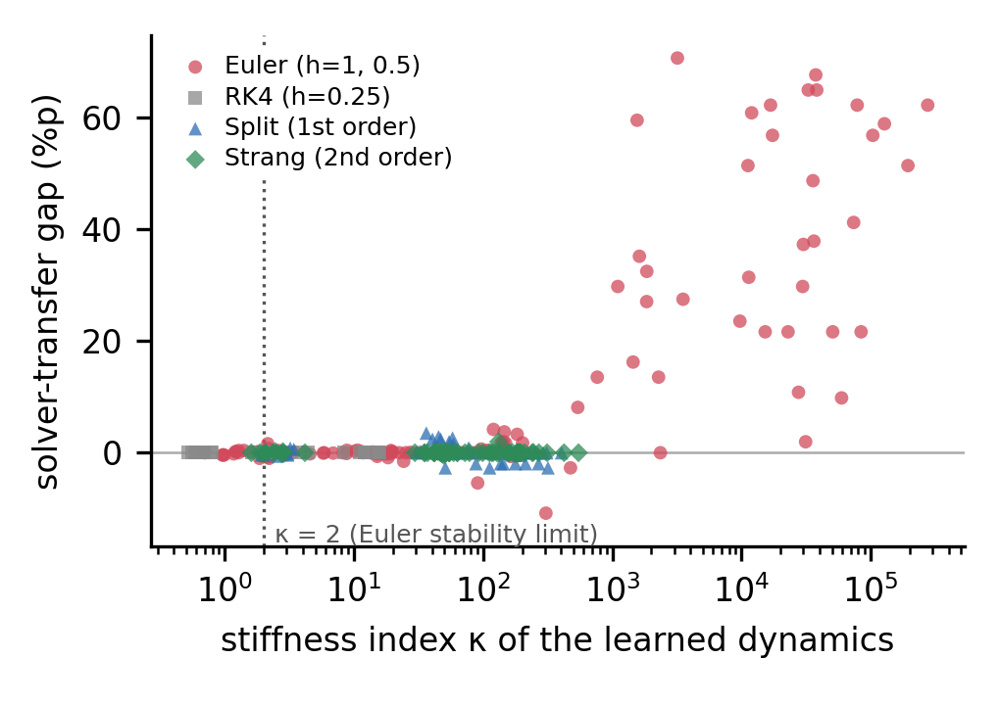

# Solver-Dependent Dynamics in Reaction-Diffusion GNNs

Continuous-depth graph neural networks compute their forward pass with a numerical integrator, and the accuracy measured with the training integrator is usually read as the accuracy of the continuous model. This repository tests that assumption for reaction-diffusion GNNs ([GREAD](https://github.com/jeongwhanchoi/GREAD), ICML 2023).

**Main findings**

- **The published GREAD-BS is safe.** With its published hyperparameters and integrators, the gap between the training integrator and a converged reference is 0–2 %p on six datasets.
- **Stiff nonlinear reactions are not.** With an Allen-Cahn reaction constrained to b > 0, the continuous dynamics are bounded. Even so, Euler-trained models lose up to 42.7 %p when the same weights are re-integrated with a converged reference (Cornell 61.4 → 18.6 %).
- **A stiffness index tracks the gap.** The index κ is computed from the learned weights alone. Across datasets, Spearman ρ(κ, gap) = 0.83. Within a dataset the relation is weaker but still significant: mean ρ = 0.27, stratified permutation p = 0.03.
- **Exact reaction flow fixes it.** Training with a splitting integrator that solves the reaction in closed form removes the gap on all six datasets (≤ 0.3 %p). It also raises the reference accuracy: Cornell +54.1, Wisconsin +26.9, Texas +18.1, Film +5.5 %p (Holm-corrected p < 0.05).
- **Generic fixes do not.** In the tested budgets, smaller Euler steps, RK4 and step-doubling consistency regularisation leave the gap or diverge during training.
- **Unbounded reactions show false stability.** With unconstrained Fisher / Zeldovich reactions, 23 of 36 checked models show a finite-time blow-up of the reference solution. A refinement ladder plus the closed-form blow-up time confirm it is not an RK4 failure. Euler still reports normal accuracy for these models.

See [RESULTS.md](RESULTS.md) for the tables and the exact definitions.

## Code (run from `GREAD/src` of the official GREAD repository)

| Script | Purpose |
|---|---|
| `rd_sweep.py` | Training runner (published hyperparameters; experiment variables overridden last; seeds fixed per split) |
| `transfer.py` | Train with one integrator, re-evaluate the same weights with many integrators; κ, q_h |
| `consist.py` | Euler vs step-doubling consistency regularisation vs Strang, with reference convergence check |
| `bs_transfer.py`, `summarize_bs.py` | Published GREAD-BS and Fisher / Zeldovich solver transfer, model-agnostic κ_gen |
| `verify_rx.py`, `summarize_verify.py` | Review checks: same-weights check, RK4 refinement ladder, analytic blow-up time, index agreement |
| `analyze_gap.py`, `analyze_more.py`, `final_stats.py` | Correlations (pooled / within-dataset / dataset-level), reverse transfer, order ablation, Holm-corrected Wilcoxon, cost |
| `paper_figs.py` | Figures and CSV tables |

Raw logs (one JSON line per trained model) are in `results/`.
